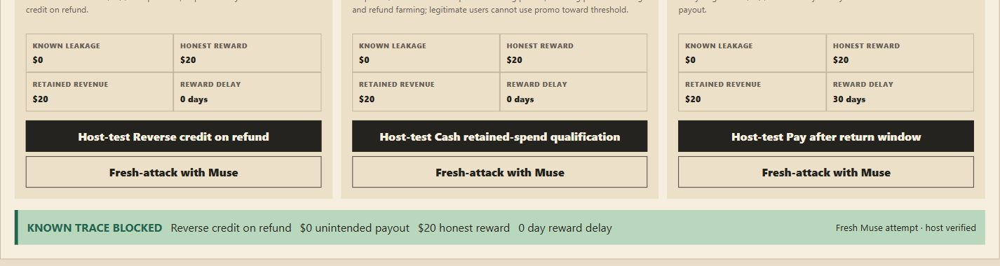

# Fine Print

> Test reward rules before they reward the wrong behaviour.

Fine Print asks Meta Muse to turn plain-English incentive rules into concrete transaction tests and repair ideas. Deterministic host simulators—not the model—execute every action, calculate every payout, and decide what the evidence proves.

[](https://github.com/JoelObinnaEze/fine-print/actions/workflows/pages.yml)

**Track:** Indie developer · **Theme:** Push the Frontier

**[Open the live demo](https://joelobinnaeze.github.io/fine-print/)** · [Follow the 60-second judge path](docs/judge-guide.md) · [Inspect the evaluation](docs/evaluation.md)



## Judge snapshot

A referral rule promised two $10 rewards after a referred customer spent $20.

1. Muse proposed four transactions.
2. The host reduced them to the three required steps: refer, purchase, refund.
3. Deterministic replay confirmed **$20 of spendable reward while the business kept $0**.
4. A second Muse check showed why immediate reversal still fails: **$10 had already been spent**.
5. Fine Print re-ranked the repairs and recommended paying after the return window: **$0 observed exposure, $20 honest reward preserved, 30-day wait**.

The Bottle Return lab applies the same boundary to a physical reward system. A recorded Muse case pays **30 points for one bottle deposited three times while recycling zero items**. The recommended rule pays once, only after an eligible item is processed.

### What to notice

| Indie criterion | What Fine Print demonstrates |
| --- | --- |
| **Creativity** | It tests whether a written rule rewards the intended real-world outcome, not merely whether code follows the rule. The same method transfers from referral credit to a 3D recycling depot. |
| **Technical ambition** | Muse interprets unfamiliar wording and proposes executable tests and repairs; strict schemas, bounded tool calls, deterministic replay, trace minimization, versioned evidence, and regression checks keep the result inspectable. |
| **Whether it works** | The public build replays checked-in Muse runs without a key. CI runs type checking, the full test suite, a high-severity dependency audit, and the production build before deployment. |

## 60-second judge path

The public build opens on the strongest confirmed result and makes no paid request.

1. **Commerce · What went wrong:** read `$20 reward`, `$0 value kept`, and the three required transactions.
2. **Commerce · Best repair:** see why immediate reversal still exposes `$10`, then inspect the delayed recommendation.
3. **Bottle Return · Your rule:** select **Load recorded case**.
4. **Bottle Return · What went wrong:** replay `30 points / 0 recycled` in the 3D depot.
5. **Bottle Return · Best repair:** inspect the processing-backed rule and its preserved honest reward.

## Why it matters

Reward software can implement a written rule perfectly and still reward behaviour its author never intended. Fine Print separates three things that are usually blurred together:

- the rule that determines payment;
- the real-world outcome the programme wants;
- the honest-customer promise a repair must preserve.

It then produces an inspectable sequence that a deterministic simulator can replay. Confirmed cases stay attached to the exact policy version and become permanent regression checks. A later unsuccessful search cannot erase an earlier confirmed failure.

## Muse proposes; the host decides

```text
Plain-English rule + intended outcome + honest-user promise
                              │
                              ▼
               Meta Muse proposes tests and repairs
                              │ untrusted JSON/tool calls
                              ▼
               strict schemas + host-enforced limits
                              │
                              ▼
        deterministic replay + payout and outcome ledgers
                              │
                              ▼
           minimized evidence + repair comparison + regression case
```

| Meta Muse does | Deterministic host does |
| --- | --- |
| Interpret unfamiliar policy wording | Validate every model response at the trust boundary |
| Form a testable hypothesis | Enforce request, trial, action, time, and cost limits |
| Propose an executable action sequence | Replay actions from an immutable initial state |
| Suggest repairs with explicit tradeoffs | Calculate payouts and outcomes, minimize evidence, and emit the verdict |

Muse cannot edit active policies, execute code, access credentials, calculate rewards, or declare success.

## Verified evidence

| Check | Model contribution | Host-verified result |
| --- | --- | --- |
| Referral reward after refund | Muse proposed 4 transactions | Reduced to 3; `$20` reward remained against `$0` retained value |
| Immediate refund reversal | Muse proposed a 5-action recheck | `$10` had already been spent and remained unrecovered |
| Pay after return window | Muse proposed the repair | `$0` observed exposure; `$20` honest reward; 30-day delay |
| Repeated bottle deposits | Recorded Muse action sequence | 30 points paid; 0 items recycled |
| Frozen evaluation | Muse attempts retained with misses and invalid sequences | 12/12 deterministic reference classifications reproduced; interpretation matrix 6/6 |

The small deterministic search baseline finds the seeded failures more consistently than Muse. Fine Print does not claim otherwise. Muse's demonstrated value is connecting unfamiliar language to inspectable tests and repair choices; independent replay supplies the evidence.

Complete provenance, limits, actions, token usage, costs, unsuccessful attempts, and deterministic baselines are preserved in [the evaluation report](docs/evaluation.md) and [machine-readable artifact](artifacts/evaluation.json). These are bounded observations, not proof that a policy is universally safe.

## Run locally

Requirements: Node.js 22.18.0 or newer and npm 11. Both Node 22 and Node 24 are verified.

```bash
npm ci
npm test
npm run typecheck
npm run build
npm run dev
```

Open `http://127.0.0.1:5173`. The recorded judge workflow needs no environment file or network call.

### Optional live Meta reproduction

Copy `.env.example` to an untracked `.env`, add your own Meta key, confirm available credits, and keep positive app/session/search caps. Then run:

```bash
npm run check:meta
npm run start:server
npm run dev
```

The API binds to `127.0.0.1:8787`. Live inference is disabled by default. The server serializes provider calls, reserves worst-case usage before each request, and retains ambiguous reservations after unknown outcomes.

## Repository map

| Path | Purpose |
| --- | --- |
| `apps/web` | Judge interface, commerce workbench, 3D depot, replay, and repair comparison |
| `apps/server` | Meta Model API boundary, budgets, persistence, run lifecycle, and verification |
| `packages/engine` | Pure Bottle Return simulator |
| `packages/commerce` | Pure referral-reward simulator and benchmarks |
| `packages/policy` | Validated policy interpretation and payout evaluation |
| `packages/evaluation` | Deterministic replay metrics and reference classifications |
| `artifacts` | Checked-in Muse runs, corrected host evidence, evaluation JSON, and screenshot |
| `tests` | Deterministic, property, provider-fixture, persistence, server, and UI coverage |

## Reproduce the project checks

| Command | Purpose |
| --- | --- |
| `npm test` | Run deterministic, property, route, provider-fixture, persistence, and UI tests |
| `npm run typecheck` | Run strict TypeScript checks |
| `npm run build` | Build the server scripts and production web application |
| `npm run evaluate` | Regenerate the offline scorecard without inference |
| `npm run check:meta` | Verify the configured Meta account and model catalog without inference |

Paid benchmark and smoke scripts are intentionally not part of the default verification path.

## Evidence and documentation

- [60-second judge guide](docs/judge-guide.md)
- [Three-minute voiceover script](docs/demo-script.md)
- [Evaluation report](docs/evaluation.md)
- [Recorded commerce investigation](artifacts/commerce-investigation-live.json)
- [Recorded repair recheck](artifacts/commerce-repair-live.json)
- [Corrected host re-verification](artifacts/commerce-repair-reverified.json)
- [Machine-readable evaluation](artifacts/evaluation.json)

## Limitations

- Fine Print evaluates only behaviours represented by its simulators and the bounded searches that were run.
- A search that finds no failure is evidence from one attempt, not a safety guarantee.
- Population examples are deterministic strategy traces, not forecasts of real customer behaviour.
- The public build replays recorded evidence; live Muse controls require a local server and private key.
- No user adoption, revenue, industrial deployment, or formal verification is claimed.

## Attribution and license

Fine Print uses React, Vite, TypeScript, Zod, Node SQLite, Vitest, Testing Library, and fast-check. The interface uses repository-authored CSS and shapes; no purchased or generated art is included. Meta Model API integration follows the official Chat Completions, tool-calling, structured-output, reasoning, and pricing documentation.

No open-source license has been selected. The repository is public for judging but is not licensed for reuse.
